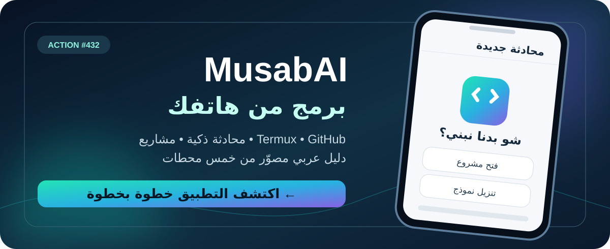
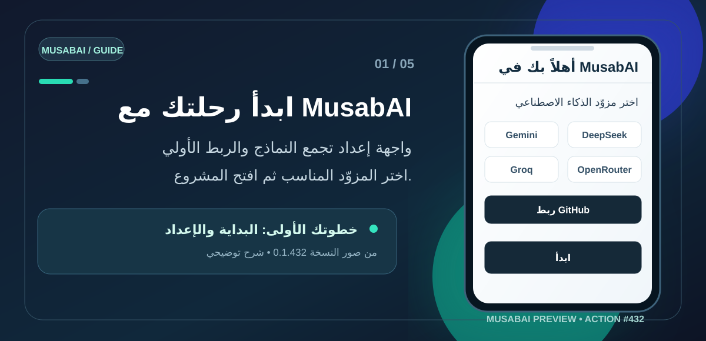
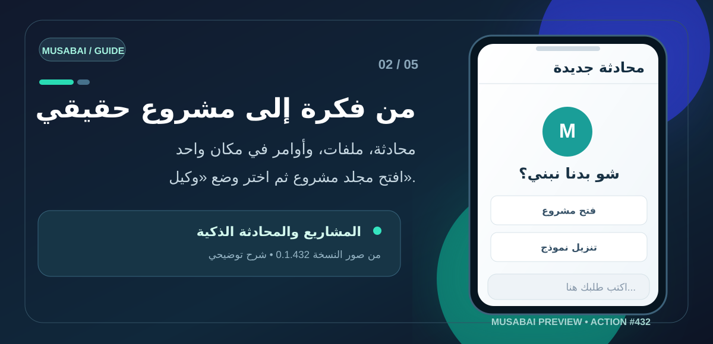
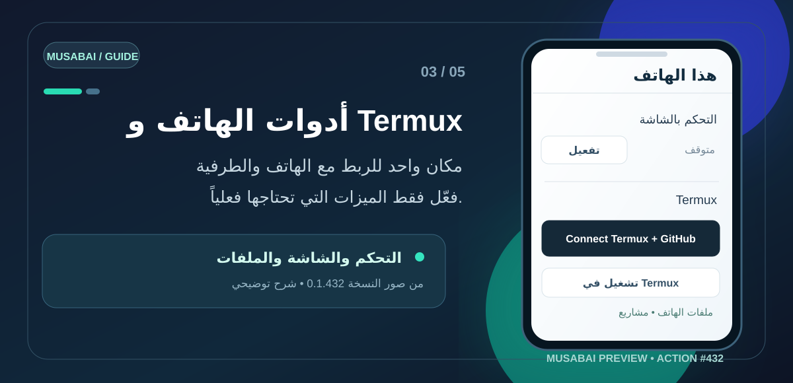
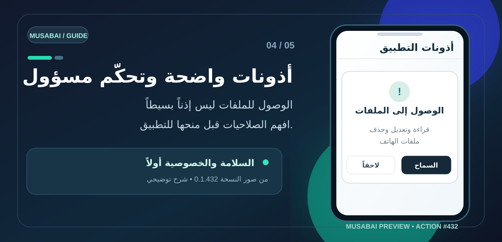
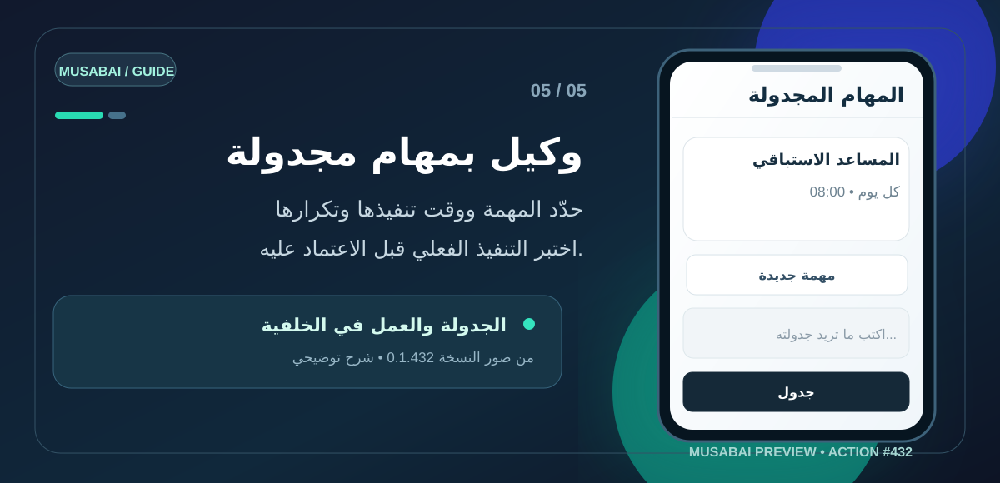

# MusabAI

## 📲 تحميل تطبيق MusabAI للأندرويد — Download APK

**✅ النسخة الأصلية من GitHub Actions #432 — جاهزة للتنزيل المباشر (38.4 MB)**

### ⬇️ [اضغط هنا لتحميل ملف MusabAI-Connectors.apk مباشرة](https://github.com/Musabgpt/NewAl-Cloud/releases/download/action-432/MusabAI-Connectors.apk)

[📋 تفاصيل الإصدار #432](https://github.com/Musabgpt/NewAl-Cloud/releases/tag/action-432) · [🛡️ فحص سلامة الملف SHA-256](https://github.com/Musabgpt/NewAl-Cloud/releases/download/action-432/MusabAI-Connectors.apk.sha256)

> هذا الرابط خاص بنسخة Action #432 حصراً، ولن ينتقل تلقائياً إلى بناء آخر.

---

## ✦ اكتشف MusabAI — الدليل العربي المصوّر

  

**تطبيق مساعد برمجي على أندرويد — من الفكرة إلى ملفات المشروع والأوامر**

[📥 تحميل التطبيق مباشرة](https://github.com/Musabgpt/NewAl-Cloud/releases/download/action-432/MusabAI-Connectors.apk) · [📦 الإصدار الأصلي #432](https://github.com/Musabgpt/NewAl-Cloud/releases/tag/action-432) · [🛡️ ملاحظات الأمان](#-قبل-أن-تمنح-الأذونات)

> **عن الصور:** هذه رسوم إرشادية صُمّمت خصيصاً لهذا المشروع بالاعتماد على لقطات حقيقية من واجهة **MusabAI Preview 0.1.432**. توضّح أماكن الميزات وخطوات استخدامها، ولا تمثل نتائج اختبار تشغيل أو إثباتاً بأن كل اتصال يعمل.

### 🧭 رحلتك في خمس خطوات

| الخطوة | ستتعرف على |
|:---:|---|
| 01 | اختيار النموذج وإعداد التطبيق |
| 02 | فتح مجلد مشروع والعمل بالمحادثة ووضع الوكيل |
| 03 | أدوات الهاتف، الشاشة، وTermux وGitHub |
| 04 | فهم صلاحيات الوصول والأمان |
| 05 | إعداد المهام المجدولة ومراجعة عملها |

---

### 01 / البداية — اجعل مساحة العمل جاهزة

**الفكرة:** عند تشغيل التطبيق تظهر شاشة ترحيب وإعداد تتيح اختيار مزوّد ذكاء اصطناعي وتعرض خيارات مثل **Gemini وGroq وOpenRouter وDeepSeek**، مع خيار ربط **GitHub**.

**كيف تبدأ؟** اختر مزوّداً تملك وسيلة استخدامه بالفعل، ثم اضغط **«ابدأ»**. ربط GitHub مفيد إذا كنت تريد التعامل مع المستودعات، لكنه يظهر في الإعداد الأول بوصفه خياراً اختيارياً.

> **معلومة مهمّة:** عرض أسماء المزوّدات، بما فيها *FreeLLMAPI · Auto Free*، لا يعني أن كل مزوّد متصل أو مجاني بلا حدود. تحقق من الاتصال الحقيقي قبل البدء بمشروع كبير.

### 02 / اكتب الفكرة — ودع المشروع يتشكل

شاشة البداية تحمل عبارة **«شو بدنا نبني؟»**، وتعرض خيارين أساسيين: **«فتح مشروع»** و**«تنزيل نموذج»**. أسفلها حقل الأوامر، واختيار النموذج، ووضع **«وكيل»**.

**تجربة مقترحة في أول مشروع:**

1. اضغط **«فتح مشروع»** ثم اختر مجلد **projects** أو أنشئ مجلداً جديداً.
2. اختر نموذجاً متاحاً، واضبط الوضع على **«وكيل»** إن أردت تنفيذ مهمة متعددة الخطوات.
3. اطلب: **«أنشئ صفحة HTML عربية بسيطة في هذا المجلد، ثم اختبر الملفات واشرح ما فعلته».**
4. راجع الملفات والنتائج بنفسك للتأكد من التنفيذ الفعلي.

يمكنك أيضاً إضافة سياق للمحادثة عبر حقل الكتابة أو خيارات الملفات، بحسب الأدوات المتاحة في نسختك.

### 03 / قدرات الهاتف — من الملفات إلى Termux

من القائمة الجانبية اختر **«هذا الهاتف: Termux والشاشة والملفات»**. تظهر فيه وسائل ربط الطرفية وGitHub، وخيارات استخدام ملفات الهاتف، إلى جانب زر تفعيل التحكم بالشاشة.

- **Termux:** تظهر أزرار **Connect Termux + GitHub** و**تشغيل في Termux**. هي نقاط بدء للربط؛ نجاح الاتصال يحتاج اختباراً.
- **ملفات الهاتف:** تساعدك واجهة المشروع على اختيار الملفات والمجلدات التي تريد العمل عليها، وفق الأذونات الفعلية الممنوحة.
- **التحكم بالشاشة:** يرتبط بخدمة إمكانية الوصول **NewAI Code: التحكم بالهاتف**. مجرد ظهور زر «تفعيل» لا يثبت أن الخدمة تعمل.

**اختبار عملي:** افتح مشروعاً تجريبياً واطلب قراءة قائمة الملفات فقط، ثم جرب أمراً غير مؤذٍ في Termux وتحقق من نتيجته.

### 04 / الأمان — أعطِ الصلاحيات عن معرفة

صور الإعداد الحقيقي أظهرت طلبات **الوصول إلى كل الملفات**، و**السماح بتنفيذ أوامر في Termux**، وإيقاف تحسين البطارية، وخدمة **إمكانية الوصول** للتحكم بالشاشة.

**هذه أذونات قوية وليست مجرد إعداد شكلي:**

- **كل الملفات:** قد يتيح قراءة وتعديل وحذف ملفات خارج مجلد المشروع.
- **أوامر Termux:** قد تسمح بتنفيذ تعليمات لها أثر على بيانات وملفات جهازك.
- **إمكانية الوصول:** قد تسمح بقراءة عناصر الشاشة وتنفيذ نقرات وإيماءات.
- **العمل بالخلفية:** قد يزيد استهلاك البطارية، ولا يضمن وحده استمرار المهام.

لذلك ابدأ بمجلد تجريبي، وتجنب منح الصلاحيات التي لا تحتاجها، ولا تحفظ أسراراً أو رموز وصول في ملفات يستطيع الوكيل قراءتها. لا تتجاوز حواجز أمان أندرويد لمجرد إكمال الإعداد.

### 05 / المساعد الاستباقي — مهام في الوقت الذي تختاره

واجهة **«المهام المجدولة»** تعرض خانة لكتابة المهمة، مع وقت التشغيل، وتكرار مثل **«كل يوم»**، وخيار يحدّد ما إذا كانت المهمة تنفَّذ عند وجود شيء مهم فقط. كما تظهر بطاقة للمساعد الاستباقي.

**مثال:** اكتب *«كل صباح، افحص ملخص أعمال مشروعي وأخبرني إن كان هناك شيء يحتاج انتباهي»*، ثم اختر الموعد واضغط **«جدول»**.

> **اختبر قبل الاعتماد:** صور الواجهة تثبت وجود أدوات الجدولة، لكنها لا تكفي لإثبات أن المهام ستُنفّذ والهاتف مقفل أو أن الإشعارات تصل في موعدها. اختبر مهمة بسيطة وتأكد من السجل والنتيجة.

---

### 🧠 كل مشروع يترك خبرة — تجربة تصبح أكثر سلاسة مع الوقت

> **«كلما استخدمت MusabAI أكثر في مشاريعك، أصبح أقدر على الاستفادة من عملك السابق، وأقل حاجة لتكرار نفس الشرح.»**

من خلال **تجربة الاستخدام**، يبرز أثر الذاكرة المرتبطة بالمشروع وحفظ الدروس والخطوات الناجحة: عندما تتكرر مهمة سبق تنفيذها، يستطيع المساعد — **إذا كانت الذاكرة مفعّلة وتم حفظ المعلومات واسترجاعها بنجاح** — الاستفادة من السياق السابق، وتجنّب بعض الخطوات المكررة، وإنجاز العمل بوقت أقل في بعض الحالات.

| 🌱 في البداية | 🧠 مع استمرار الاستخدام |
|:---|:---|
| تشرح هيكل المشروع وما تريد فعله | يمكنه استحضار معلومات سبق حفظها عن المشروع |
| تحدد الأدوات والخطوات المفضلة | يستطيع الاستفادة من خطوات ونتائج ناجحة سابقة |
| تعيد شرح بعض المهام المتشابهة | قد يقلّ الشرح المتكرر وتصبح المهمة أسرع |

**✨ يعمل جيداً مع الخيارات المجانية، ويمكن توسيع قدراته باختيار نموذج أقوى.**

- **مع النماذج المجانية:** يمكن أن يكون رفيقاً عملياً للبرمجة والشرح وتنظيم المهام، مع مراعاة حدود السرعة والحصص وتوفر الخدمة.
- **مع نموذج مدفوع أقوى:** قد تتحسن جودة التحليل وكتابة الكود وفهم المسائل المعقدة، وقد تزيد سرعة الإنجاز بحسب النموذج والمزوّد وطبيعة المهمة. **الدفع لا يعني بالضرورة زمناً أقل لكل استجابة.**
- **مع الاستخدام المتكرر:** الفائدة الأساسية تأتي من **ذاكرة المشروع والسياق والدروس المحفوظة**، وليس من أن أوزان نموذج الذكاء الاصطناعي نفسه تتدرّب تلقائياً على هاتفك.

**ملاحظة توضيحية:** هذه انطباعات مرتبطة بتجربة الاستخدام وآلية الذاكرة، وليست نتيجة قياس معياري منشور يضمن تحسناً ثابتاً في الذكاء أو السرعة. تعتمد النتيجة على النموذج المختار، والذاكرة، وجودة الاتصال، وتعقيد المهمة.

---

### 🌍 MusabAI للجميع — ابنِ، طوّر، وشارك ما تعلّمته

> **«MusabAI مشروع ينمو بمساهمات الجميع. جرّبه، افهم طريقة عمله، طوّره، وإذا وصلت إلى نتيجة أفضل، شارك تجربتك كي يستفيد منها الجميع.»**

**الكود المصدري متاح علناً** على GitHub، ونرحّب بمن يرغب في استخدامه والمساهمة في تطويره أو تجربة تعديلات وتحسينات عليه، مع **الحفاظ على اسم MusabAI والإشارة إلى المستودع الأصلي عند مشاركة نسخة مبنية عليه**.

#### 🤝 من تجربة شخصية إلى تحسين يستفيد منه المجتمع

1. **استخدم MusabAI** في مشروعك واكتشف ما يساعدك وما يحتاج إلى تطوير.
2. **طوّر وجرّب:** حسّن الأداء أو الواجهة أو الذاكرة أو الأدوات أو تكاملات النماذج.
3. **قارن النتائج:** سجّل ما تغيّر، وكيف اختبرت التحسين، وما الذي أصبح أدق أو أسرع.
4. **شارك تجربتك مع المشروع الأصلي:** افتح [Issue لعرض النتيجة أو اقتراح التحسين](https://github.com/Musabgpt/NewAl-Cloud/issues/new) أو قدّم [Pull Request لدمج تعديلك](https://github.com/Musabgpt/NewAl-Cloud/pulls)، مع شرح الخطوات ونتائج الاختبار.

**رؤيتنا:** أن تتحول التجارب الفردية الناجحة إلى معرفة وتحسينات مشتركة، مع بقاء اسم **MusabAI** واضحاً كهوية للمشروع الذي بدأت منه الفكرة.

> **توضيح بشأن الترخيص:** المستودع عام وتُرحّب صفحته بالمساهمات، لكنه لا يحتوي حالياً على ملف `LICENSE` رسمي. لذلك لا تُعد هذه الدعوة وحدها ترخيصاً قانونياً مفتوح المصدر يمنح حقوق النسخ أو التعديل أو إعادة التوزيع. يلزم نشر ترخيص مناسب يحدّد هذه الحقوق وشرط الحفاظ على الاسم، مع مراعاة حقوق أي مكوّنات أو أكواد خارجية.

---

### ✨ ماذا يمكن أن يكون MusabAI بالنسبة لك؟

**مساعد مشاريع على هاتفك:** مكان واحد للتفكير في التطبيق، وفتح ملفاته، وطلب تغييرات على الكود، والاطلاع على الأدوات الموصولة بالهاتف. الهدف هو الانتقال من **«عندي فكرة»** إلى **«عندي مشروع أستطيع فحصه»**.

| 🧠 النماذج | 🗂️ المشاريع | ⚡ الوكيل |
|:---:|:---:|:---:|
| اختيار المزوّد المناسب | فتح مجلدات العمل | طلب تنفيذ خطوات متعددة |
| 🖥️ Termux | 🔗 GitHub | ⏰ المهام |
| أوامر الطرفية عند الربط | مستودعات الكود عند التفويض | جدولة التعليمات واختبارها |

### 🚀 جاهز تجرب التطبيق؟

**نسخة MusabAI Preview من البناء الأصلي Action #432 — دون خلط بأي إصدار آخر**

[رابط APK مباشر](https://github.com/Musabgpt/NewAl-Cloud/releases/download/action-432/MusabAI-Connectors.apk) • [عرض الإصدار وملف التحقق SHA-256](https://github.com/Musabgpt/NewAl-Cloud/releases/tag/action-432)

---

## Developer documentation

Android coding assistant with persistent project memory, document tools, official OAuth/MCP connections, Termux execution and tested engine candidates.

This development line starts from successful Action 216 (`d8a270382c51e009148fc2ae034beb40788fdf6c`). It keeps that build's pinned Action 43 Python engine and byte-verified Action 125 native libraries.

## Using the app

- Start or open a project conversation, then use **Workspace / مساحة العمل** for Files, Memory and Improve.
- Files supports HTML, Markdown, PDF, ZIP and TXT import, creation, reading and export.
- Memory is local and project-scoped. Search its Arabic/English lessons and evidence, delete them or disable capture. Observed corrected tool calls can become lessons; this does not train model weights.
- Improve prepares a separate Python engine candidate. Packaged regression tests run before activation. Explicitly restart the engine after activation; Restore original selects the packaged engine. Android rechecks the code and app build before startup.
- Connections uses the deployed broker and native account vault. Current provider status and remaining registration requirements are in [REGISTRATION.md](connectors/hosted/REGISTRATION.md).
- The agent's `bash` commands run in the project and stream into the existing terminal pane as well as the conversation. Background servers use `bash(background=true)` and `job`. Shell permission checks and cancellation remain active; installing Termux is not required for the built-in shell.
- Each model request includes the actual terminal availability, permission mode and connected service tool counts, refreshed within existing conversations. The behavior profile requires relevant tools for execution and live account tasks, with build/test/repair guidance. This does not guarantee compliance by every model or install missing SDKs.
- **Connections → Add MCP server / إضافة خادم MCP** adds a remote Streamable HTTP endpoint to the current project, with an optional Bearer token. Test and add performs real initialization and paginated tool discovery before saving. Re-test and removal are supported; the running conversation refreshes its tools on its next request. Credentials live in a private app configuration file (mode 0600), outside project files and API listings. Custom browser OAuth and stdio installation are not part of this form; official OAuth services keep their existing connection cards.
- Android built-ins now include the existing Accessibility UI reader plus `screenshot`, `install_apk` (Android confirmation remains required), notification reading after the user enables Notification Access, and `automation_start/stop/list/replay`. `MusabTestBridge` exposes crash, test and ANR-report files for debug APKs; it does not pretend to read another app's Logcat. These are local phone capabilities and do not require wireless debugging or MCP.
- Model transport uses a real fallback pool. Kilo Auto Free is attempted without a key; OpenRouter, Groq, Cerebras, Gemini and Hugging Face free tiers are used when their own environment key is present. Overload, timeout, network and HTTP failures move to the next configured provider and the successful provider is recorded. Free-tier quotas and model names can change, so unconfigured entries are skipped instead of shown as connected.
- The built-in MCP catalog includes the official Microsoft Playwright MCP repository and the official MCP reference server templates (filesystem, memory and fetch). `/api/mcp-bundles` reports actual local runtime availability. Playwright/reference servers are started only where `node`/`npx` exists; no fake tools or hidden downloads are claimed. MusabAI's native files, memory and phone capabilities remain available when those runtimes are absent.

## Behavior profile

[agent_prompt.md](connectors/agent_prompt.md) adapts the user's uploaded `claude-code-cloud-fable-5.1.md` behavior instructions to MusabAI's actual tools and identity. The upload also contained another person's account/session context, repository directions and tool catalogs; those are not runtime configuration for this application. They are not included in the APK or this repository.

Source upload SHA-256: `a51e2376a001d5708b00762440d065e689a264b4de4f7f3ba55cd72f2b1ba863`.

The profile applies to default cloud/local conversations, including reopened conversations using the old built-in prompt. Messages and project instructions are preserved.

## Build and test

Root Gradle and `android-lite` build the same application: `dev.newal.code.lite.connectors`. Obsolete standalone chat source was removed and remains recoverable in Git history.

Run **MusabAI — Android** (`.github/workflows/android.yml`). It tests pinned agent integration, memory, Python/JavaScript/Java contracts and original engine features; then packages the verified native baseline and builds the APK. Download `MusabAI-Connectors` from the successful run.

Local UI tests: `npm ci --prefix connectors && npm test --prefix connectors`.
Memory tests: `python3 -m unittest discover -s desktop/autonomy -p 'test_*.py' -v`.
Set `NEWAL_UPSTREAM` to a Git checkout of pinned Musabgpt/NewAl source for agent integration tests.

The free default model endpoint can change availability and rate limits. Recalled memories enter the selected model's context like conversation text. Candidate checks execute with the application's OS permissions. Development signing and physical-phone acceptance are documented in [DEPLOYMENT.md](connectors/DEPLOYMENT.md).

See [applied recommendations and verification scope](connectors/EVOLUTION.md).

